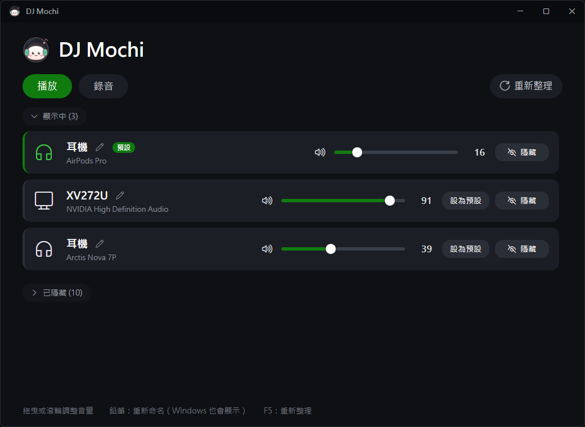

# 🍡 DJ Mochi

[](https://github.com/rity860102/dj-mochi/actions/workflows/build.yml)
[](https://github.com/rity860102/dj-mochi/releases/latest)
[](LICENSE)


**DJ Mochi 的 Windows 音訊裝置管理工具**：隱藏用不到的裝置、一鍵切換預設、調整音量，還能幫裝置改名字，而且 Windows 的音效選單也會顯示新名稱。

- 使用 Windows 內建的 .NET Framework 4.8，**不用安裝任何東西**
- **不需要系統管理員權限**
- 從點開到視窗出現約 **0.3 秒**
- 介面採 Xbox 深色風格，標題列做成 Discord 那樣的自訂樣式



---

## 功能

| 功能 | 說明 |
|------|------|
| **顯示 / 隱藏** | 隱藏後，Windows 的音效選單和各程式（Discord、遊戲…）都選不到這個裝置。效果等同「設定 → 系統 → 音效 → 裝置 → **不允許**」 |
| **設為預設** | 一鍵切換 Windows 預設的輸出或輸入裝置，會同時套用到一般、多媒體、通訊三種用途 |
| **音量 / 靜音** | 每個裝置都有自己的音量滑桿和靜音按鈕，滑桿上可以用滾輪微調（每格 ±2） |
| **重新命名** | 改完名字，**Windows 的音效選單也會顯示新名稱**，跟 Windows 設定裡的「重新命名」是同一個功能。原始名稱會備份，隨時可以還原 |
| **分區收合** | 「顯示中」「已隱藏」兩個區塊都可以收合，已隱藏的裝置會縮排、以精簡列顯示 |
| **縮到右下角** | 按「最小化」會縮到右下角的通知區域；點圖示叫回視窗，右鍵選單可以**不開視窗直接切換預設播放裝置**。按 X 則直接結束程式 |
| **開機自動啟動** | 點「開機啟動」按鈕或右下角選單打開，會出現在工作管理員的「啟動應用程式」，開機後直接縮在右下角 |
| **防多開** | 已經開著時再點一次，不會開第二個，會把原本的視窗叫出來（縮在右下角時也可以） |

### 安全機制
- **播放裝置至少要保留一個顯示**，避免全部隱藏後電腦沒有聲音
- **隱藏預設裝置要二次確認**：按下「隱藏」後，會出現灰色「取消」和紅色「確認隱藏？」兩個按鈕
- 程式發生非預期的錯誤時會跳出提示，不會直接閃退

---

## 下載與使用

**系統需求**：Windows 10 / 11（64 位元）。Windows 內建 .NET Framework 4.8，不用另外安裝。

1. 到 [Releases](../../releases) 下載 `DJMochi.exe`，或依照下方[建置](#建置)步驟自己編譯
2. 直接執行，不需要安裝。建議在檔案上按右鍵 →「釘選到工作列」

> 第一次執行時，Windows SmartScreen 可能會顯示「Windows 已保護您的電腦」，因為這個 exe 沒有數位簽章。點「其他資訊」→「仍要執行」即可。不放心的話，可以自己從原始碼編譯。

| 操作 | 方式 |
|------|------|
| 切換播放 / 錄音 | 點上方的「播放」「錄音」 |
| 隱藏 / 顯示 | 點每列右側的按鈕 |
| 設為預設 | 點「設為預設」 |
| 調整音量 | 拖曳滑桿，或在滑桿上用滾輪 |
| 靜音 | 點滑桿左邊的喇叭圖示，靜音時會變紅 |
| 重新命名 | 點名稱旁的鉛筆 → 輸入名稱 → **Enter 或再按一次鉛筆**儲存，**Esc** 取消 |
| 還原名稱 | 點名稱旁的還原按鈕，或把名稱清空後儲存 |
| 重新整理 | **F5** 或點「重新整理」 |

> 程式不會自動偵測外部變更。在 Windows 設定、Sonar 裡改了裝置，或插拔耳機之後，請按 **F5** 重新整理。

### 設定會保留嗎？
**會。** 所有設定都直接寫進 Windows 自己的音訊設定，重新開機後依然有效，不用每次重設，平常也不需要開著這個工具。

以下情況可能會被 Windows 重設，再開工具設定一次就好：
- 更新或重裝音效驅動程式（Realtek、NVIDIA 等）
- 耳機或接收器換插到另一個 USB 孔，Windows 可能會當成新裝置
- Windows 大版本更新
- SteelSeries GG / Sonar 更新時，可能會重新啟用它的虛擬裝置

---

## 檔案結構

```
dj-mochi\
├─ DJMochi.exe             主程式（編譯產生，不進 git）
├─ original-names.json        原始名稱備份（第一次改名時自動建立，不進 git，請勿刪除）
├─ README.md
├─ LICENSE
├─ .github\workflows\
│  └─ build.yml              CI / CD 設定
├─ docs\
│  └─ screenshot.png
└─ src\
   ├─ DJMochi.cs           原始碼（C# 5 / WPF）
   ├─ build.ps1               編譯腳本
   └─ icon\
      ├─ make-icon.ps1        圖示繪製腳本（WPF 向量繪圖）
      ├─ mochi.ico            exe 圖示（16～256 px）
      ├─ mochi.png            程式內使用的圖示（256 px，會內嵌進 exe）
      └─ preview.png          各尺寸預覽圖（產生後不進 git）
```

---

## 建置

用 Windows 內建的 C# 編譯器（`C:\Windows\Microsoft.NET\Framework64\v4.0.30319\csc.exe`）編譯，不需要 Visual Studio 或 .NET SDK。

```powershell
# 編譯 exe（輸出到專案根目錄的 DJMochi.exe）
pwsh -File src\build.ps1

# 修改圖示後，重新產生 ico / png，再重新編譯
pwsh -File src\icon\make-icon.ps1
pwsh -File src\build.ps1
```

> ⚠️ 編譯前要先關閉正在執行的 `DJMochi.exe`，否則會因為檔案被鎖住而無法覆寫。

本機編譯的版本號預設是 `0.0.0-dev`，也可以用 `-Version` 指定：

```powershell
pwsh -File src\build.ps1 -Version 1.2.0
```

版本號會寫進 exe，在檔案上按右鍵 →「內容」→「詳細資料」可以看到。

### CI / CD（GitHub Actions）

設定檔在 `.github/workflows/build.yml`，在 GitHub 的 Windows 主機上用同一個 `build.ps1` 編譯。

| 觸發 | 動作 |
|------|------|
| 推送到 `main` | 編譯 → **依 commit 類型自動決定版本號 → 建立 Release**，附上 `DJMochi.exe`、`DJMochi.exe.sha256` |
| 推送 `v*` tag | 用該 tag 的版本號建立 Release（需要手動指定版本時用） |
| 發 PR、手動執行 | 只編譯，exe 存成 Artifact（版本 `0.0.0-dev+<commit>`） |

**發布新版本 = 正常 commit 並 push 到 `main`**。版本號依照上次發布之後的 commit 訊息（[Conventional Commits](https://www.conventionalcommits.org/zh-hant/)）自動遞增：

| 上次發布後的 commit | 版本變化 | 例子 |
|---|---|---|
| 有 `feat:` | 第二碼 +1 | `1.0.0` → `1.1.0` |
| 只有 `fix:`、`refactor:`、`perf:` 等 | 第三碼 +1 | `1.1.0` → `1.1.1` |
| 有 `feat!:` 或內文有 `BREAKING CHANGE` | 第一碼 +1 | `1.1.0` → `2.0.0` |
| 全部都是 `docs:`、`ci:`、`chore:`、`style:`、`test:` | **不發布**，只跑 CI | |
| 最新 commit 訊息含 `[skip release]` | **不發布** | |

Release 的更新說明會依 commit 紀錄自動產生，發布後可以在 GitHub 上再手動編輯。

### 開發注意事項
- 內建的 `csc.exe` **只支援 C# 5 語法**，不能用 `$"..."` 字串插值、`?.`、`=>` 運算式成員、`nameof`、`out var` 等新語法
- 原始碼是 UTF-8，`build.ps1` 已經加上 `/codepage:65001`
- 圖示和中文要放在**不同的 TextBlock**。如果共用 `Segoe Fluent Icons, Microsoft JhengHei UI` 這種混合字型，中文會變成方框
- `make-icon.ps1` 裡不能用 `[ordered]@{}` 加整數鍵，PowerShell 會把整數當成索引而不是鍵

---

## 技術原理

| 功能 | 使用的 Windows API |
|------|------------------|
| 顯示 / 隱藏 | `IPolicyConfig::SetEndpointVisibility` |
| 設為預設 | `IPolicyConfig::SetDefaultEndpoint`（Console / Multimedia / Communications 三種角色） |
| 重新命名 | `IPolicyConfig::SetPropertyValue` 寫入 `PKEY_Device_DeviceDesc` |
| 音量 / 靜音 | `IAudioEndpointVolume` |
| 讀取預設裝置 | `IMMDeviceEnumerator::GetDefaultAudioEndpoint` |
| 裝置清單 | 讀取登錄檔 `HKLM\SOFTWARE\Microsoft\Windows\CurrentVersion\MMDevices\Audio\{Render,Capture}` |

`IPolicyConfig` 是 Windows「聲音」控制台自己在用的 COM 介面（`CPolicyConfigClient`，CLSID `870AF99C-171D-4f9e-AF0D-E63DF40C2BC9`，位於 `AudioSes.dll`）。微軟沒有公開文件，但從 Windows 7 以來一直保持穩定。

**裝置狀態**（登錄檔 `DeviceState`）：

| 值 | 意義 |
|----|------|
| `0x1` | 啟用 |
| `0x2` | 停用 |
| `0x4` | 不存在（已移除的裝置，工具不會列出） |
| `0x8` | 未接上 |
| `0x10000000` 旗標 | 被「不允許」隱藏，例如 `0x10000001` |

### 為什麼不用裝置管理員的「停用」？
裝置管理員層的停用（`Disable-PnpDevice`）需要系統管理員權限，而且停用後音訊服務不一定會同步，Windows 的音效選單還是可能看得到。用 `SetEndpointVisibility` 才跟 Windows 設定的「不允許」完全一致。

### 為什麼從 PowerShell 改成 C#？
最早的版本是 PowerShell + WPF，但光是 PowerShell 啟動就要約 0.5 秒，從點開到視窗出現大約 0.75 秒。改用 C# 編譯成 exe 後降到約 0.3 秒，記憶體也從約 100 MB 降到約 80 MB。

---

## 常見問題

**Q：「喇叭 (Steam Streaming Speakers)」是什麼？**
Steam 遠端暢玩（Remote Play）用的虛擬裝置，從這台電腦串流遊戲到 Steam Link、Steam Deck 或手機時才會用到。平常可以隱藏，不影響串流功能。

**Q：用 SteelSeries Sonar 的話，哪些裝置不能隱藏？**
不要隱藏實體耳機（例如 AirPods、Arctis），Sonar 要透過它們出聲。Windows 預設輸出設成 `Sonar - Gaming`，Discord 的輸出設成 `Sonar - Chat`、輸入設成 `Sonar - Microphone`。

**Q：AirPods 出現兩個（一般和 Hands-Free）？**
Hands-Free 是通話模式，音質較差，但可以用 AirPods 的麥克風。不用 AirPods 麥克風的話，可以把 Hands-Free 隱藏，避免程式自動切換到通話模式。

**Q：工作列還顯示舊圖示？**
這是 Windows 的圖示快取。把舊的釘選取消，再重新釘選就好。

---

## 授權

[MIT License](LICENSE)。DJ Mochi 圖示同樣適用 MIT 授權。
