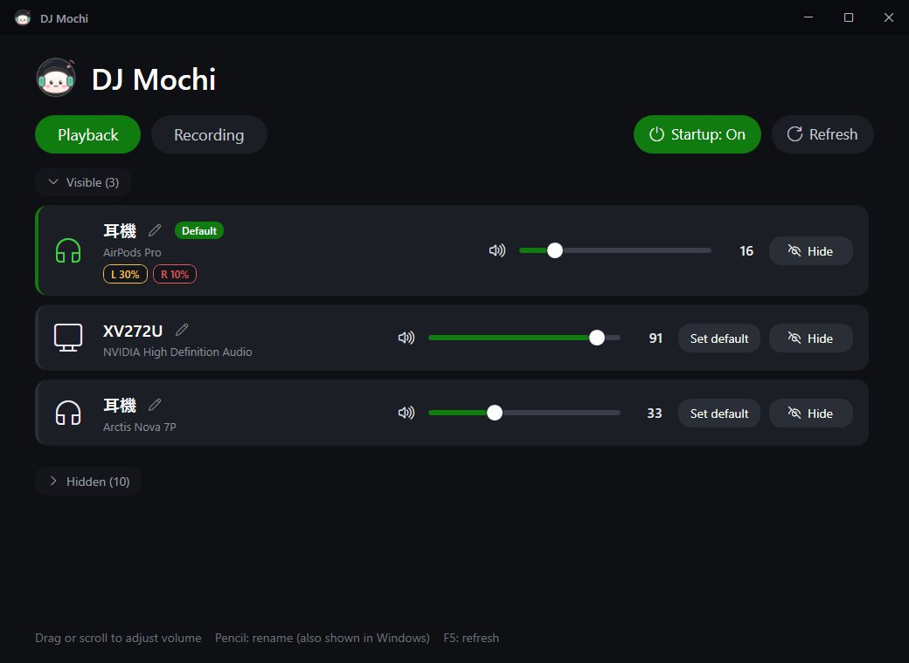

# 🍡 DJ Mochi

**English** | [繁體中文](README.zh-TW.md)

A lightweight audio device manager for Windows. Hide the devices you never use, switch between headphones and speakers in one click, adjust each device's volume, and give your devices names you can actually recognize.

- **No installation**: a single exe that runs on the .NET Framework 4.8 built into Windows
- **No administrator rights needed**
- **Fast**: the window opens in about 0.3 seconds
- **Settings live in Windows**: they stay in effect after you close the app or restart your PC

---

## Features

### 🔊 Device management
- **Show / hide**: hidden devices disappear from the Windows sound menu, and apps like Discord or games can't pick them either. Same as "Don't allow" in Windows Settings
- **Set default**: switch the default output or input device in one click
- **Volume / mute**: every device gets its own volume slider; scroll the mouse wheel for fine control
- **Rename**: new names **also show up in the Windows sound menu**. The original name is backed up so you can restore it anytime

### 🎧 AirPods battery
- When your AirPods are the default playback device, their row shows the **left, right and case** battery levels, with ⚡ while charging
- Battery is only read while the window is open and the AirPods are the default device. Nothing scans in the background
- Levels are shown in 10% steps. That's the precision AirPods broadcast, so every device other than an iPhone sees the same

### 📌 Lives in the notification area
- **Minimize to the notification area**: click the icon to bring the window back. Right-click it to **switch the default playback device without opening the window**. The X button exits the app
- **Start with Windows**: once enabled, DJ Mochi appears under Task Manager → Startup apps and starts minimized
- **Single instance**: launching the exe again brings the existing window back
- **English / 繁體中文**: follows your Windows display language by default. Switch manually from the notification area menu → "Language / 語言"

### 🛡️ Safeguards
- At least one playback device always stays visible, so you never end up with no sound at all
- Hiding the current default device asks for confirmation first

---

## Download

**Requirements**: Windows 10 / 11 (64-bit)

1. Download `DJMochi.exe` from [Releases](https://github.com/rity860102/dj-mochi/releases/latest)
2. Put it in any folder and run it. No installation needed
3. Tip: right-click the exe → "Pin to taskbar"

> The first time you run it, Windows SmartScreen may show "Windows protected your PC" because the exe isn't code-signed. Click "More info" → "Run anyway". If you'd rather not, you can build it from source yourself (see the [development guide](docs/DEVELOPMENT.md), in Traditional Chinese).

**Upgrading**: close the old version and replace the exe. All your settings are kept.

---

## How to use

| To do this | Do this |
|---|---|
| Switch between playback and recording devices | Click "Playback" / "Recording" at the top |
| Hide / show a device | Click "Hide" / "Show" on the right side of its row |
| Change the default device | Click "Set default", or right-click the notification area icon → "Default playback device" |
| Adjust volume | Drag the slider, or scroll over it |
| Mute | Click the speaker icon left of the slider (turns red when muted) |
| Rename | Click the pencil next to the name → type a name → Enter to save, Esc to cancel |
| Restore the original name | Click the restore button next to the name, or save an empty name |
| Start with Windows | Click "Startup" at the top right |
| Change language | Right-click the notification area icon → "Language / 語言" |
| Refresh | Press F5, or click "Refresh" |

> If you change devices in Windows Settings or another app, or plug / unplug headphones, press **F5** to refresh.

---

## FAQ

**Are my settings kept?**
Yes. Everything is written directly into Windows' own audio settings, so it survives restarts and you don't need to keep DJ Mochi running.
Windows may reset a device in these cases; just open DJ Mochi and set it again:
- Updating or reinstalling audio drivers
- Plugging headphones or a receiver into a different USB port (Windows may treat it as a new device)
- Major Windows updates

**My AirPods battery doesn't show up**
- Make sure the AirPods are the **default playback device** and Bluetooth is on
- AirPods don't broadcast every second, so it can take 10+ seconds after opening the window
- AirPods stop broadcasting once they're in a closed case. The case battery usually only shows with the lid open

**Why are there two AirPods entries (normal and Hands-Free)?**
Hands-Free is the call mode. It sounds worse but lets apps use the AirPods microphone. If you don't use the AirPods mic, hide it so apps don't switch to call mode on their own.

**What are "Steam Streaming Speakers / Microphone"?**
Virtual devices used by Steam Remote Play when streaming games from this PC to another device. You can safely hide them; streaming still works.

**I use a virtual mixer like SteelSeries Sonar**
Don't hide your physical headphones, since the mixer plays sound through them. Set the default device to one of the mixer's virtual devices (for example `Sonar - Gaming`).

**Device names show up in another language**
Device names like "Headphones" come from Windows and follow its display language. Use the pencil button to rename them.

**The taskbar still shows the old icon**
That's the Windows icon cache. Unpin the old shortcut and pin the exe again.

---

## Development

Build steps, CI/CD and technical details are in [docs/DEVELOPMENT.md](docs/DEVELOPMENT.md) (Traditional Chinese).

## License

[MIT License](LICENSE). The DJ Mochi icon is also MIT licensed.
