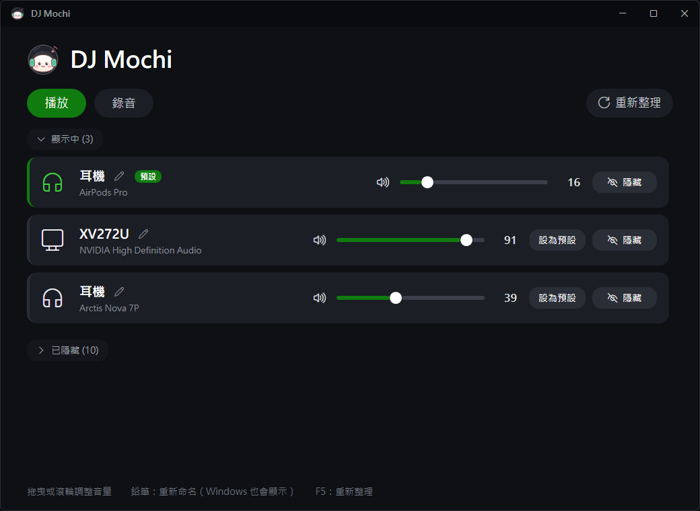

# 🍡 DJ Mochi

[English](README.md) | **繁體中文**

輕巧的 Windows 音訊裝置管理工具。把用不到的裝置藏起來、一鍵切換耳機和喇叭、個別調整音量，還能幫裝置取個好認的名字。

- **免安裝**：單一 exe，使用 Windows 內建的 .NET Framework 4.8
- **不需要系統管理員權限**
- **開得快**：點開到視窗出現約 0.3 秒
- **設定寫進 Windows**：關掉程式、重新開機後依然有效

---

## 功能

### 🔊 裝置管理
- **顯示 / 隱藏**：隱藏的裝置不會出現在 Windows 的音效選單，Discord、遊戲等程式也選不到。效果等同 Windows 設定裡的「不允許」
- **設為預設**：一鍵切換預設的輸出 / 輸入裝置
- **音量 / 靜音**：每個裝置都有自己的音量滑桿，也可以用滑鼠滾輪微調
- **重新命名**：改完名字，**Windows 的音效選單也會顯示新名稱**。原始名稱會自動備份，隨時可以還原

### 🎧 AirPods 電量
- AirPods 是預設播放裝置時，會在那一列顯示**左耳、右耳、充電盒**的電量，充電中會加上 ⚡
- 只在視窗開著、而且 AirPods 是預設裝置時才讀取，平常不會在背景掃描
- 電量精度為 10%（AirPods 對外廣播的精度就是 10%，iPhone 以外的裝置都只能讀到這個精度）

### 📌 常駐小工具
- **縮到右下角**：按最小化會縮到通知區域；點圖示叫回視窗，右鍵選單可以**不開視窗直接切換預設播放裝置**。按 X 則直接結束程式
- **開機自動啟動**：打開後會出現在工作管理員的「啟動應用程式」，開機時直接縮在右下角
- **防多開**：已經開著時再點一次 exe，會把原本的視窗叫出來
- **繁體中文 / English**：預設跟隨 Windows 的顯示語言，也可以在右下角選單的「語言 / Language」手動切換

### 🛡️ 防呆
- 播放裝置至少會保留一個，避免全部隱藏後沒有聲音
- 隱藏目前的預設裝置時，需要再按一次確認

---

## 下載與安裝

**系統需求**：Windows 10 / 11（64 位元）

1. 到 [Releases](https://github.com/rity860102/dj-mochi/releases/latest) 下載 `DJMochi.exe`
2. 放到任何資料夾直接執行，不需要安裝
3. 建議在 exe 上按右鍵 →「釘選到工作列」

> 第一次執行時，Windows SmartScreen 可能會顯示「Windows 已保護您的電腦」，因為這個 exe 沒有數位簽章。點「其他資訊」→「仍要執行」即可。不放心的話，可以參考[開發說明](docs/DEVELOPMENT.md)自己從原始碼編譯。

**升級**：關閉舊版，用新的 exe 取代即可，所有設定都會保留。

---

## 使用方式

| 想做的事 | 操作 |
|---|---|
| 切換播放 / 錄音裝置清單 | 點上方的「播放」「錄音」 |
| 隱藏 / 顯示裝置 | 點每列右側的「隱藏」/「顯示」 |
| 切換預設裝置 | 點「設為預設」，或在右下角圖示按右鍵 →「預設播放裝置」 |
| 調整音量 | 拖曳滑桿，或在滑桿上用滾輪 |
| 靜音 | 點滑桿左邊的喇叭圖示（靜音時變紅） |
| 重新命名 | 點名稱旁的鉛筆 → 輸入名稱 → Enter 儲存、Esc 取消 |
| 還原原始名稱 | 點名稱旁的還原按鈕，或把名稱清空後儲存 |
| 開機自動啟動 | 點右上角的「開機啟動」 |
| 切換語言 | 在右下角圖示按右鍵 →「語言 / Language」 |
| 重新整理 | 按 F5，或點「重新整理」 |

> 在 Windows 設定或其他軟體裡改了裝置、或插拔耳機之後，按 **F5** 重新整理。

---

## 常見問題

**設定會保留嗎？**
會。所有設定都直接寫進 Windows 的音訊設定，重新開機後依然有效，平常不需要開著 DJ Mochi。
不過以下情況 Windows 可能會重設裝置，再打開 DJ Mochi 設定一次就好：
- 更新或重裝音效驅動程式
- 耳機或接收器換插到另一個 USB 孔（Windows 可能會當成新裝置）
- Windows 大版本更新

**AirPods 電量沒有顯示？**
- 確認 AirPods 是**預設播放裝置**，而且藍牙有開
- AirPods 不是每秒都在廣播，打開視窗後可能要等十幾秒
- 耳機收進盒子、蓋上蓋子後就不會廣播；充電盒的電量通常要打開盒蓋才讀得到

**AirPods 出現兩個（一般和 Hands-Free）？**
Hands-Free 是通話模式，音質較差，但可以用 AirPods 的麥克風。不用 AirPods 的麥克風的話，可以把它隱藏，避免程式自動切換到通話模式。

**「Steam Streaming Speakers / Microphone」是什麼？**
Steam 遠端暢玩（Remote Play）用的虛擬裝置，從這台電腦串流遊戲到其他裝置時才會用到。平常可以隱藏，不影響串流。

**有用 SteelSeries Sonar 之類的虛擬混音軟體？**
不要隱藏實體耳機，混音軟體要透過它們出聲。預設裝置請設成混音軟體建立的虛擬裝置（例如 `Sonar - Gaming`）。

**工作列還顯示舊圖示？**
這是 Windows 的圖示快取，把舊的釘選取消再重新釘選就好。

---

## 開發

建置方式、CI/CD、技術原理請見 [docs/DEVELOPMENT.md](docs/DEVELOPMENT.md)。

## 授權

[MIT License](LICENSE)。DJ Mochi 圖示同樣適用 MIT 授權。
